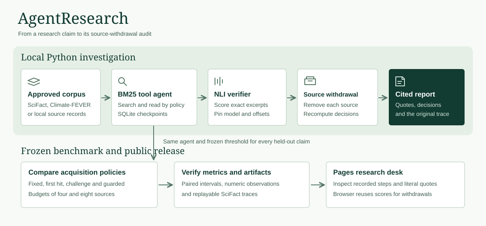

# AgentResearch

AgentResearch investigates a claim against a corpus you choose and shows which sources its verdict depends on. Read the exact sentences the model scored, withdraw one abstract, and see whether the verdict survives. The Python agent runs new investigations. The browser desk lets you inspect and re-audit recorded runs. [Open the research desk](https://sashankpotluru.github.io/AgentResearch/) · [Source code](https://github.com/Sashankpotluru/AgentResearch)

## Try a real disagreement

The desk opens on SciFact development claim **636**, about the reaction catalyzed by PTEN. SciFact labels it **SUPPORTS**. Challenge, with a four-source budget, searched twice, read four abstracts, scored eight excerpts, and returned **REFUTES**. Open the source drawer and withdraw **scifact:22025252**, *Changes in the levels of inositol phosphates after agonist-dependent hydrolysis of membrane phosphoinositides*. The verdict becomes **INSUFFICIENT**. The trace still shows what the model originally read. This is the first of 40 demo claims selected by a hash of the claim ID before inspecting outcomes. [Original run and sources](site/data/claims/636.json) · [SciFact paper](https://aclanthology.org/2020.emnlp-main.609/)

Three parts of the investigation can be inspected separately. The tool trace shows how a bounded policy chose each source and where it stopped. The evidence report binds each model judgment to the retained source text and offsets. A leave-one-source-out audit removes every scored sentence from the selected source before recomputing the verdict. This lets a researcher distinguish an acquisition miss, a questionable sentence judgment and a conclusion resting on one abstract. [Method](docs/method.md) · [Versioned trace format](docs/format.md)



## Held-out results

The primary comparison in the frozen protocol was challenge versus fixed with eight reads. **Challenge scored lower on SciFact and slightly higher on Climate-FEVER. Both paired macro F1 intervals include zero.** The table reports all four policies on the 300 SciFact development claims and 1,535 Climate-FEVER test claims. Each also ran with a four-read budget, for 14,680 held-out investigations. Coverage includes INSUFFICIENT. Error is measured only over covered claims. [Measured results, both budgets](results/summary.csv) · [Intervals and confusion matrices](results/summary.json)

| Dataset | Policy | Accuracy | Macro F1 | Coverage | Error if covered | Mean reads | Mean NLI pairs |
|---|---|---:|---:|---:|---:|---:|---:|
| SciFact | Fixed | 35.7% | 0.364 | 100.0% | 64.3% | 8.00 | 16.00 |
| SciFact | First hit | 42.7% | 0.430 | 100.0% | 57.3% | 3.94 | 7.88 |
| SciFact | Challenge | 32.7% | 0.335 | 100.0% | 67.3% | 8.00 | 16.00 |
| SciFact | Guarded | 25.3% | 0.272 | 70.3% | 64.0% | 8.00 | 16.00 |
| Climate-FEVER | Fixed | 25.1% | 0.208 | 100.0% | 74.9% | 8.00 | 14.57 |
| Climate-FEVER | First hit | 27.4% | 0.215 | 100.0% | 72.6% | 4.21 | 7.68 |
| Climate-FEVER | Challenge | 25.7% | 0.212 | 100.0% | 74.3% | 8.00 | 14.13 |
| Climate-FEVER | Guarded | 22.0% | 0.186 | 78.2% | 71.9% | 8.00 | 14.13 |

Challenge minus fixed changed macro F1 by **−0.0295** on SciFact (paired 95% component interval −0.0640 to +0.0012) and **+0.0039** on Climate-FEVER (−0.0022 to +0.0241). Climate's paired claim-level interval was −0.0068 to +0.0148. The largest evidence-sharing component contains 1,040 of 1,535 climate claims, limiting inference from resampled components. Each interval used 2,000 paired draws. [Protocol](experiments/protocol.json) · [Measurement details](docs/evaluation.md)

First hit used 3.94 reads on SciFact and 4.21 on Climate-FEVER. Its observed accuracy exceeded fixed by 7.0 and 2.35 percentage points, respectively. Guarded reduced conditional error relative to challenge in both datasets while abstaining on 29.7% of SciFact and 21.8% of Climate-FEVER. Even among covered climate claims its error was 71.9%. Challenge recovered only 17 of 124 SciFact support labels and 31 of 654 climate support labels. Exact quote binding was 100% for these two challenge configurations. The classification failures remain visible in the released confusion matrices. [Results](results/summary.json) · [Limitations](docs/limitations.md)

## Run it locally

From a checkout, use Python 3.12 or later in a virtual environment. This command installs the base package and runs the core tests.

```sh
python -m pip install -c requirements-lock.txt '.[test]' && python -m pytest -q
```

Replay the entire public release, including the per-claim decision and withdrawal observations, the published SciFact traces and the bootstrap intervals.

```sh
python scripts/verify_release.py --results results --site-dir site/data \
  --frozen-calibration experiments/calibration.json
```

For a new claim, install the model extra and follow the model download instructions. The verifier checks all seven model and tokenizer files against the lock. Then point the CLI at the included corpus or a corpus of your own. [Pinned model download](docs/model.md)

```sh
python -m pip install -c requirements-lock.txt '.[model]'
mkdir -p .artifacts
agentresearch run --claim "Leaf exposure affects photosynthesis." \
  --corpus results/scifact/corpus.jsonl --model-dir .artifacts/model \
  --policy challenge --budget 4 --threshold 900000 --db .artifacts/runs.sqlite \
  --run-id leaf-exposure > .artifacts/run.json
agentresearch report .artifacts/run.json results/scifact/corpus.jsonl --bundle > .artifacts/bundle.json
```

Import the bundle in the browser to explore source withdrawals. To expose search, reading, investigation and audit tools to an MCP host, install `.[mcp,model]` and start the stdio server. The CLI also supports PubMed abstract acquisition, checkpoint resume and offline Markdown reports. The model smoke and held-out inference ran locally. The public CI workflow checks Python 3.12/3.13, MCP, JavaScript decision parity and artifact replay. [Local workflows](docs/reproduce.md) · [MCP and PubMed](docs/integrations.md) · [CI runs](https://github.com/Sashankpotluru/AgentResearch/actions/workflows/ci.yml)

## Data and reuse

The benchmark uses 5,183 SciFact abstracts and 5,240 Climate-FEVER evidence sentences pooled into 1,344 article sources. The runtime receives claim text and the search corpus. Gold labels and per-claim evidence associations enter at evaluation. A separate calibration split of 537 SciFact training claims, filtered to avoid cited-document overlap with development, selected the shared threshold of 900,000 millionths. [Dataset provenance](docs/datasets.md) · [Frozen calibration](experiments/calibration.json) · [Acquisition hashes](data/sources.json)

The release includes a checksum manifest, observations for every policy and budget, all 300 SciFact trace groups and both output summaries. Climate-FEVER's author dataset card lists the license as unknown. Its public artifacts contain derived numerical observations. Reacquire the authors' text locally for Climate source-level verification. The model's scores are uncalibrated. Withdrawal stability can reflect correlated sources, and abstract retrieval can miss relevant studies. [Release files](results/) · [Checksums](results/manifest.json) · [Reproduction guide](docs/reproduce.md)

SciFact and Climate-FEVER established the claim-and-evidence tasks used here. PaperQA2 studied language agents for scientific literature research. AgentResearch measures four explicit acquisition policies and the dependence of their decisions on individual sources. Reports identify the verdicts as automated NLI assessments and preserve the exact premises for human review. [SciFact](https://aclanthology.org/2020.emnlp-main.609/) · [Climate-FEVER](https://arxiv.org/abs/2012.00614) · [PaperQA2](https://arxiv.org/abs/2409.13740) · [NLI model](https://huggingface.co/cross-encoder/nli-deberta-v3-small)

Original code is MIT licensed. SciFact claims and annotations use CC BY 4.0 and the S2ORC abstracts use ODC-By 1.0. The pinned model is Apache 2.0. Cite the software and the original material used in your analysis. [Software citation](CITATION.cff) · [MIT license](LICENSE) · [Attribution and data terms](THIRD_PARTY_NOTICES.md)
